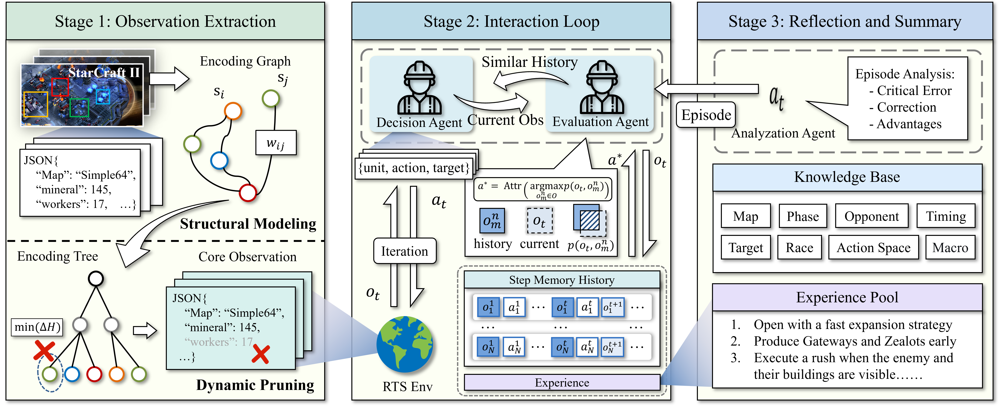

# ESMA

[](https://www.python.org/)
[](LICENSE)

Minimal code-only release of **ESMA**, an LLM-based agent framework for decision-making in real-time strategy environments.

<p align="center">
  
</p>

<p align="center"><em>Overview of the ESMA framework.</em></p>

## Development status

This repository currently provides a minimal, code-only implementation of the core ESMA workflow. The public code is still being organized and refined; interfaces, configuration, and module boundaries may change in later revisions. The latest paper-aligned implementation and additional documentation will be released incrementally after verification.

Bug reports and focused improvements are welcome. Please avoid relying on undocumented internal behavior until a stable release is announced.

This repository intentionally contains no process data, experiment outputs, stored memories, raw observations, generated experiment plots, presentation files, or model caches.

## Structure

```text
.
├── src/esma/
│   ├── agents/               # Decision, analysis, evaluation, and game agents
│   ├── envs/                 # StarCraft II action definitions
│   ├── structuralization/    # Graph construction and observation pruning
│   └── utils/                # Structural-information utilities
├── assets/                   # Framework overview image
├── main.py                   # Minimal executable entry point
├── pyproject.toml            # Package metadata
└── requirements.txt          # Runtime dependencies
```

## Requirements

- Python 3.10 or newer
- StarCraft II installed locally
- Required StarCraft II maps installed separately
- An OpenAI-compatible model endpoint

StarCraft II binaries, maps, and third-party model assets are not redistributed.

## Installation

```bash
git clone <repository-url>
cd ESMA
python -m venv .venv
python -m pip install -e .
```

Activate the environment before installation when appropriate for your operating system.

## Configuration

Credentials must be provided through environment variables:

```powershell
$env:ESMA_API_KEY = "your-decision-model-key"
$env:ESMA_SUMMARY_API_KEY = "your-summary-model-key"
$env:ESMA_API_BASE = "https://example.com/v1"
$env:ESMA_SUMMARY_API_BASE = "https://example.com/v1"
$env:ESMA_MODEL = "decision-model-name"
$env:ESMA_SUMMARY_MODEL = "summary-model-name"
```

Optional memory files can be supplied externally through `ESMA_MEMORY_EARLY`, `ESMA_MEMORY_MID`, and `ESMA_MEMORY_LATE`. They are not included in this code-only release. If unset, the evaluation expert starts with empty memories.

See `.env.example` for the complete variable list. The project does not automatically load `.env` files.

## Running

From the repository root:

```bash
python main.py
```

Review the map, opponent difficulty, episode count, and real-time setting in the module before running. LLM calls may incur external service costs.

## Data policy

The repository excludes and ignores:

- raw and processed research data;
- saved memories and observation traces;
- experiment results, histories, and logs;
- generated figures and analysis outputs;
- downloaded models and caches;
- credentials, IDE metadata, bytecode, and internal presentations.

Publish datasets or results separately through an archival service if they are needed for paper reproducibility.

## Citation

## License

The code is provided under the MIT License. Third-party software, game assets, maps, models, and services remain subject to their own terms.
